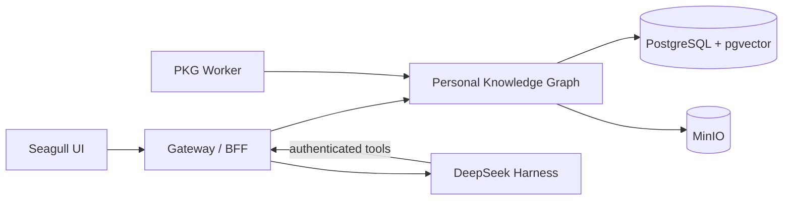

<p align="center">
  
</p>

<h1 align="center">Seagull Knowledge Assistant</h1>

<p align="center">
  Turn scattered information into durable knowledge—and durable knowledge into polished output.
</p>

<p align="center">
  <a href="README.md">English</a> · <a href="README.zh-CN.md">简体中文</a>
</p>

Seagull is a self-hosted knowledge workspace that connects information capture, research, writing, and publishing. Build a searchable personal knowledge graph, work with agents, and turn your knowledge into reviewable **Assets**—articles, research briefs, newsletters, diagrams, and illustrated WeChat drafts.

## Features

- **Collect and discover** — import PDF, Office, Markdown, HTML, and images; collect web pages, RSS, GitHub, papers, and news; review discovery candidates before keeping them.
- **Search with context** — structured filters, vector search, hybrid retrieval, and traceable source references; optional web search to fill knowledge gaps.
- **Organize knowledge** — linked Sources, Notes, and Wiki pages; note pinning, image attachments, and version history; PDF mind maps with source-linked nodes and branch expansion.
- **Organize Projects** — define goals and completion criteria, link existing knowledge, Assets, and chats, and choose a next step from shared Todos. Link task context and explicit Note/Asset results; Overview shows pending actions and recent results. Launch Workflows after reviewing bounded context, with per-message snapshots and re-confirmation when context changes. Saved Chat outputs can explicitly link to a Project and optional Todo; failed link retries reuse the saved object. Wiki drafts link to Projects only. Unscheduled, dated, and recurring tasks share Calendar Todos; moves preserve their resources. Project memory, project-only retrieval, and automatic result linking remain deferred.
- **Stay on top of your work** — to-dos, calendar reminders, review suggestions, and knowledge usage statistics.
- **Work with agents** — chat, reusable workflows, presets, skills, tools, persistent sessions, execution traces, and user-confirmed memory. An optional read-only WeRead tool accesses books, highlights, reviews, and reading statistics.
- **Create and improve Assets** — clarify intent, review evidence and claims, edit structured drafts, and optimize the complete document with quality checks; Settings → Dashboard groups knowledge overview, usage rankings, and global or Project-filtered Asset blockers into tabs. Project Outputs reuse the same diagnostics; optional global journey reviews supplement recovery and adoption feedback.
- **Generate publishing visuals** — AI-planned covers, social images, and inline illustrations, with editable prompts, multiple candidates, and explicit review.
- **Create Podcast episodes** — paste a finished script or search the web and explicitly save selected summaries as materials; link Projects, choose from 48 voices, and review opt-in Agent candidates before saving and confirming. Preview segmentation and budget at no charge; separately authorized audio tasks provide progress and authenticated MP3 downloads. Synthesis is disabled by default and requires deployment setup; no automatic retries or publishing.
- **Automate recurring work** — scheduled collection, discovery, digests, and newsletters, with optional cover generation and visible background job status.

## From Knowledge to Publishable Assets

1. **Define the brief** — choose the audience, question, and goal yourself, or discuss them with an agent before confirming.
2. **Review the research** — search your knowledge first, optionally supplement with web results, and accept or reject evidence and candidate claims. Search summaries are not automatically verified facts.
3. **Draft and optimize** — edit Markdown blocks, request targeted edits or whole-document restructuring, and run multiple optimization rounds informed by quality audits. Review proposed changes, apply them to the editor, then explicitly save.
4. **Add visuals** — use the Visual Planner and style presets to generate 1–4 candidates for covers, square/portrait social images, or block-linked illustrations. Compare, retry, cancel, and select images; edit their alternative text. Image generation runs asynchronously through Qwen Image (DashScope).
5. **Deliver** — preview and export Markdown or styled HTML with approved visuals and Mermaid diagrams, or send an illustrated draft to your WeChat Official Account. Newsletter automation can generate a cover; image failure does not discard the text draft, and automatic acceptance requires explicit configuration.
6. **Keep what you learned** — review the Asset's contribution and proposed Note/Wiki content before promoting it into long-term knowledge.

Generated images are publishing materials, not factual sources or evidence. Agents can propose edits and visual candidates, but final acceptance, knowledge promotion, and publishing remain under your control.

## Architecture



| Service | Responsibility | Port |
| --- | --- | ---: |
| [`personal_knowledge_graph/`](personal_knowledge_graph/) | Durable knowledge, retrieval, assets, connectors, and scheduled jobs | `8000` |
| [`seagull-ui/`](seagull-ui/) | Supported React product interface | `5173` |
| [`bff/`](bff/) | Authentication-aware Gateway for PKG and Harness | `4000` |
| [`deepseek-knowledge-lab/`](deepseek-knowledge-lab/) | Harness profiles, plugins, agent workflows, and experiments | `3080` |

`deepseek-knowledge-lab/dsh-harness` is maintained as a Git submodule.

## Quick Start

### Requirements

- Python 3.12
- Node.js 22+
- Docker with Compose
- Git with submodule support

### Install

```bash
git clone --recurse-submodules https://github.com/CherryYin/seagull-knowledge-assistant.git
cd seagull-knowledge-assistant
./scripts/bootstrap.sh
```

Create local environment files:

```bash
cp personal_knowledge_graph/.env.example personal_knowledge_graph/.env
cp seagull-ui/.env.example seagull-ui/.env
cp bff/.env.example bff/.env
cp deepseek-knowledge-lab/.dsh/.env.example deepseek-knowledge-lab/.dsh/.env
```

Configure the provider keys and secrets you need. Image generation uses `QWEN_API_KEY` and `QWEN_IMAGE_*` in the PKG environment; optional web search uses `TAVILY_API_KEY`. For the read-only WeRead tool, add `WEREAD_API_KEY` to the Harness environment and load `weread-skills`. WeChat draft delivery requires Official Account credentials configured in the app.

Then start the platform:

```bash
npm run stack:check
npm run stack:start
```

Open `http://127.0.0.1:5173`.

If Harness or the frontend is already running outside this script, confirm it is the intended instance and run `npm run stack:start -- --reuse-existing`. These responding services stay unmanaged (shown as `external` in status); stack stop/restart and logs do not control them. Add `--skip-worker` to avoid starting scheduled jobs, or use `npm run stack:stop -- --keep-infra` to leave the database available to external services.

When upgrading an existing installation, apply PKG migrations (`cd personal_knowledge_graph && .venv/bin/alembic upgrade head`) before restarting the PKG API and Gateway. Projects are available from the sidebar and the Projects button on resource details.

```bash
npm run stack:status   # inspect services
npm run stack:logs     # follow logs
npm run stack:stop     # stop the platform
npm test               # run repository checks
```

## Design Principles

- PKG owns durable user knowledge; Harness owns agent execution.
- The Gateway owns browser and Harness authentication boundaries.
- Agent proposals do not automatically become final Assets or long-term knowledge; automation uses explicitly configured policies.
- Real `.env` files, credentials, personal content, and runtime state stay local.
- Cross-service contracts evolve together across PKG, Gateway, UI, and Harness plugins.

## Explore Further

- [PKG overview](personal_knowledge_graph/README.md)
- [Platform architecture](docs/platform/architecture.md)
- [Development guide](docs/platform/development.md)
- [Asset journey review](seagull-ui/ASSET_JOURNEY_REVIEW.md)
- [Knowledge Lab](deepseek-knowledge-lab/README.md)

## License

Seagull Knowledge Assistant is released under the [MIT License](LICENSE).
