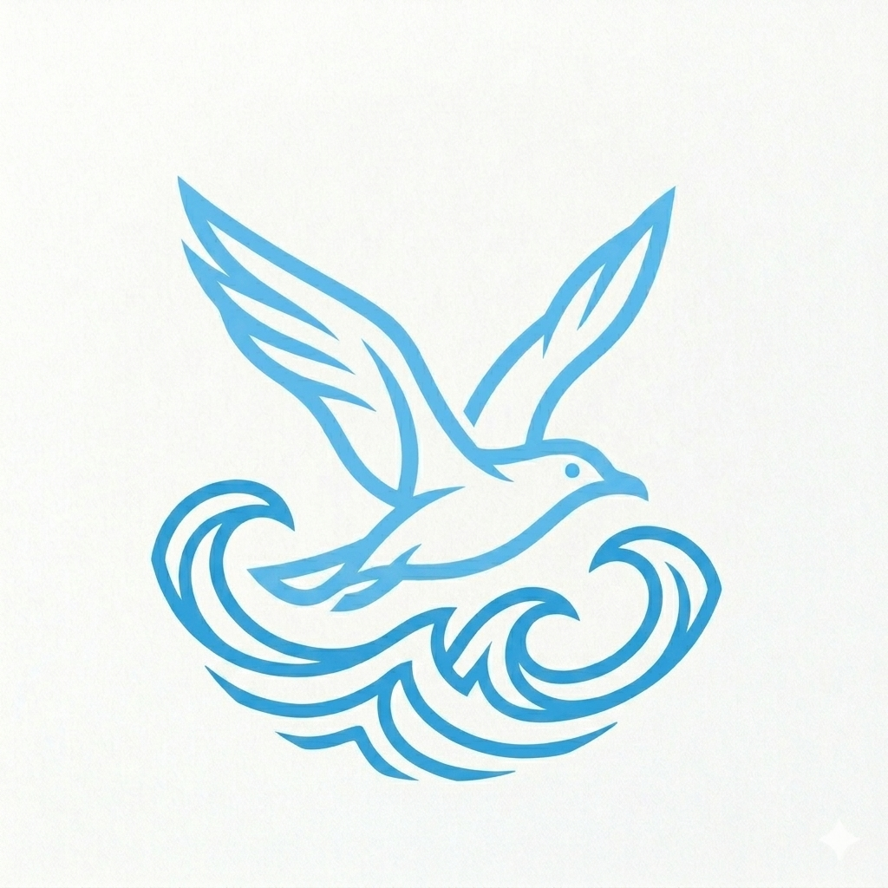
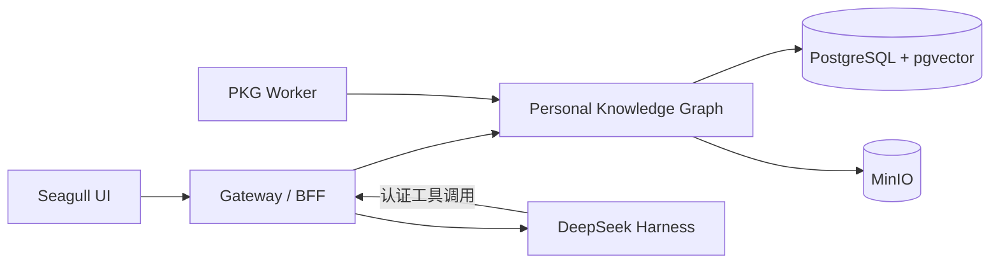

<p align="center">
  
</p>

<h1 align="center">Seagull Knowledge Assistant</h1>

<p align="center">
  让零散信息沉淀为长期知识，再让知识自然流动为优质产物。
</p>

<p align="center">
  <a href="README.md">English</a> · <a href="README.zh-CN.md">简体中文</a>
</p>

Seagull 是一个串联信息采集、研究、写作与发布的自托管知识工作台。构建可检索的个人知识图谱，与 Agent 协作，再将知识转化为可审阅的 **Asset（内容资产）**：文章、研究简报、Newsletter、图表和图文微信公众号草稿。

## 核心功能

- **采集与发现**：导入 PDF、Office、Markdown、HTML 和图片，采集网页、RSS、GitHub、论文与新闻，审阅发现候选后再收录。
- **有据可查的检索**：结构化过滤、向量搜索、混合检索与来源追踪；可选联网搜索补充知识缺口。
- **知识组织**：关联 Sources、Notes 与 Wiki，支持笔记置顶、图片附件和版本历史；PDF 思维导图支持来源定位与分支扩展。
- **日常管理与回顾**：待办、日历提醒、回顾建议与知识使用统计。
- **Agent 协作**：对话、可复用工作流、Preset、Skill、Tool、持久会话、执行轨迹和用户确认的记忆；可选微信读书只读工具，查询书籍、划线、书评与阅读统计。
- **Asset 创作与优化**：澄清意图、审阅证据与结论、编辑结构化草稿，结合质量检查进行多轮整篇优化；Settings → Dashboard 按标签展示知识总览、使用排行与全部个人 Asset 的功能卡点，使用复盘补充手动补救和成品采用反馈。
- **发布生图**：AI 规划封面、社交分享图与正文插图，支持编辑提示词、生成多个候选并逐一审阅。
- **定时自动化**：持续采集、发现、Digest 与 Newsletter，可选自动生成封面，并查看后台任务状态。

## 从知识到可发布的 Asset

1. **明确创作意图**：自行填写受众、问题与目标，或先与 Agent 讨论，再确认创作方向。
2. **审阅研究依据**：优先检索个人知识库，可选 Web 补缺；逐项接受或拒绝 Evidence（证据）与 Claim（候选结论）。搜索摘要不会自动视为已核验事实。
3. **成稿与多轮优化**：编辑 Markdown 内容块，让 Agent 局部修改或整篇重组，结合质量审计逐轮优化；先审阅候选、应用到编辑器，再显式保存。
4. **生成发布配图**：通过视觉规划器与风格预设，为封面、社交方图／竖图或关联正文块的插图生成 1～4 个候选；支持对比、重试、取消、选用和编辑替代文本。生图通过 Qwen Image（DashScope）异步执行。
5. **预览与交付**：预览、导出包含已选配图与 Mermaid 图表的 Markdown／排版 HTML，或发送图文草稿到微信公众号。Newsletter 可自动生成封面，图片失败不丢弃文字草稿；自动接受图片需显式配置。
6. **沉淀新增知识**：审阅 Asset 的贡献与 Note／Wiki 候选，再确认写入长期知识库。

生成图片仅作为发布素材，不作为事实来源或证据。Agent 可以提出修改和配图候选，最终接受、知识沉淀与发布仍由用户掌控。

## 系统架构



| 服务 | 职责 | 端口 |
| --- | --- | ---: |
| [`personal_knowledge_graph/`](personal_knowledge_graph/) | 持久知识、检索、资产、连接器与调度任务 | `8000` |
| [`seagull-ui/`](seagull-ui/) | 正式 React 产品界面 | `5173` |
| [`bff/`](bff/) | 连接 PKG 与 Harness 的认证网关 | `4000` |
| [`deepseek-knowledge-lab/`](deepseek-knowledge-lab/) | Harness 配置、插件、Agent 工作流与实验 | `3080` |

`deepseek-knowledge-lab/dsh-harness` 以 Git submodule 方式维护。

## 快速开始

### 环境要求

- Python 3.12
- Node.js 22+
- Docker + Compose
- 支持 submodule 的 Git

### 安装

```bash
git clone --recurse-submodules https://github.com/CherryYin/seagull-knowledge-assistant.git
cd seagull-knowledge-assistant
./scripts/bootstrap.sh
```

创建本地环境变量文件：

```bash
cp personal_knowledge_graph/.env.example personal_knowledge_graph/.env
cp seagull-ui/.env.example seagull-ui/.env
cp bff/.env.example bff/.env
cp deepseek-knowledge-lab/.dsh/.env.example deepseek-knowledge-lab/.dsh/.env
```

按需配置模型服务密钥和安全参数。生图使用 PKG 环境中的 `QWEN_API_KEY` 与 `QWEN_IMAGE_*`，可选联网搜索使用 `TAVILY_API_KEY`。使用微信读书只读工具时，在 Harness 环境中添加 `WEREAD_API_KEY` 并加载 `weread-skills`；微信公众号草稿投递需在应用内配置公众号凭据。

然后启动完整平台：

```bash
npm run stack:check
npm run stack:start
```

访问 `http://127.0.0.1:5173`。

```bash
npm run stack:status   # 查看服务状态
npm run stack:logs     # 跟踪日志
npm run stack:stop     # 停止平台
npm test               # 运行仓库检查
```

## 设计原则

- PKG 负责持久化用户知识，Harness 负责 Agent 执行。
- Gateway 负责浏览器与 Harness 的认证边界。
- Agent 候选不会自动成为最终 Asset 或长期知识；自动化遵循用户显式配置的策略。
- 真实 `.env`、凭证、个人内容与运行状态只保留在本地。
- PKG、Gateway、UI 与 Harness 插件的跨服务契约保持同步。

## 深入了解

- [V2 优化历史与收口决策](docs/v2-progress.md)
- [PKG 介绍](personal_knowledge_graph/README.zh-CN.md)
- [平台架构](docs/platform/architecture.md)
- [开发指南](docs/platform/development.md)
- [Asset 使用复盘](seagull-ui/ASSET_JOURNEY_REVIEW.md)
- [Knowledge Lab](deepseek-knowledge-lab/README.md)

## 开源协议

Seagull Knowledge Assistant 基于 [MIT License](LICENSE) 开源。
